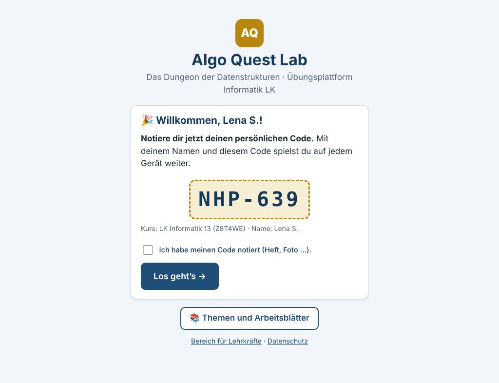

# Algo Quest – Das Dungeon der Datenstrukturen

Unterrichtsreihe **und** Übungsplattform für die Einheit **Algorithmik und Datenstrukturen** im Informatik-LK
(eA, Niedersachsen, Abitur ab 2027; Grundlage: Kerncurriculum 2017 + Ergänzende Hinweise Neufassung 2025 = „EH“).

Dieses Dokument hat drei Aufgaben:

1. Es beschreibt **vollständig**, was Algo Quest ist, wie es aufgebaut ist und wie es betrieben wird (Teil A–F).
2. Es ist die **Blaupause** für vergleichbare Plattformen zu den übrigen Themen der Informatik-Oberstufe mit anderen
   Sachkontexten. Teil G richtet sich ausdrücklich an neue Claude-Chats, die eine solche Plattform aufbauen sollen.
3. Es beschreibt die **Anbindung an den Plattform-Verbund InfoLabs** (Teil H): gemeinsames Login über das Portal
   https://labs.frankjuchim.de (SSO), Verbund-API, Plattform-Manifest. Der Vertrag selbst (v1.1) liegt im Repo
   `frankjuchim/labs` (`VERTRAG.md`) und ist für alle Plattformen verbindlich.

Live: **https://algoquest.frankjuchim.de** · Themenübersicht ohne Anmeldung: `/themen` · Gastmodus zum Reinschnuppern: `/gast`



---

## Inhalt

- [A. Das Konzept](#a-das-konzept)
- [B. Was im Repository steckt](#b-was-im-repository-steckt)
- [C. Die Plattform (Algo Quest Lab)](#c-die-plattform-algo-quest-lab)
- [D. Inhalte: Aufgabenformat und Materialien](#d-inhalte-aufgabenformat-und-materialien)
- [E. Qualitätssicherung](#e-qualitätssicherung)
- [F. Betrieb, Datenschutz, Sicherheit, API](#f-betrieb-datenschutz-sicherheit-api)
- [G. Blaupause: eine neue Plattform für ein anderes Thema](#g-blaupause-eine-neue-plattform-für-ein-anderes-thema)
- [H. Der Plattform-Verbund InfoLabs](#h-der-plattform-verbund-infolabs)
- [Anhang: API im Detail](#anhang-api-im-detail)

---

## A. Das Konzept

### A.1 Grundidee

Ein Thema des Abiturs wird als **Spielwelt mit durchgehendem Sachkontext** erzählt (hier: ein Dungeon-Spiel, das die
Lernenden im Laufe der Einheit „bauen“). Jede Doppelstunde ist ein **Level**, jede Welt endet mit einem **Boss**
(Abitur-Training auf Zeit). Gelernt wird doppelt:

- **auf Papier** – Arbeitsblätter, Papier-Bosse, Klausuren im Abitur-Format (handschriftlich, wie im Abitur),
- **im Lab** – automatisch geprüfte Aufgaben im Abitur-Stil mit sofortiger Rückmeldung, Tipps und Erklärungen.

Programmiert wird in der **Online-IDE** (online-ide.de, Bibliothek „Niedersachsen“) mit vorbereiteten Gerüsten und
JUnit-Tests – die IDE bleibt extern und vergibt keine Punkte.

### A.2 Didaktische Bausteine

| Baustein | Zweck | Wo |
|---|---|---|
| **Welten** (0–6) | Gliederung der Einheit nach Kompetenzen, je eine Farbe und ein Teil der Story | Lab-Weltkarte, Materialordner |
| **Level** (1 je DS) | ein Lernziel, Merkkasten, 6–8 Aufgaben steigender Stufe ★–★★★ | Lab, Arbeitsblatt „Im Lab üben“ |
| **Arbeitsblatt** je Level | Infoteile, Beispiele, Aufgaben auf Papier, Lösung (LSG) für die Lehrkraft | `materialien/Welt*/2_Arbeitsblaetter`, `5_Loesungen` |
| **Boss** je Welt | Abi-Probe auf Zeit: online (Ziehung aus Pool, kein Feedback, Auswertung am Ende) und als Papier-Boss mit Erwartungshorizont | Lab, `4_Boss` |
| **Trainingsplatz** | Zufallsaufgaben aus Generatoren, unbegrenzt üben (1 Punkt, max. 30/Tag) | Lab |
| **Warm-up-Karten** | 10 Minuten zum Stundenbeginn; Leitner-Trainer im Lab ohne Punkte, als Karten zum Drucken | Lab, `Werkzeuge/Warm-up-Karten` |
| **Fallen P1–P10** | die zehn häufigsten Punktverluste im Abitur, überall gleich nummeriert (Aufgaben, Profil „Deine Fallen“, Kurs-Auswertung, Materialien) | `src/domain.js`, SPEC W6 §2 |
| **Werkzeugkarten** | Abi-Check, Zeitbudget, Notation (Struktogramm, Klassendiagramm, Signaturen) | `Werkzeuge/` |
| **Punkte, Ränge, Abzeichen** | Motivation – entstehen **nur automatisch** im Lab, keine manuelle Vergabe, keine Erfahrungspunkte-Währung | Lab |
| **Teams** | feste Tischgruppen | Unterricht |
| **Erklärvideos** | je Welt ein Video auf YouTube (Kanal „frankjuchim“), Folien mit Kamera-Zone | `materialien/Videos` (nicht öffentlich) |

### A.3 Verbindliche fachliche Konventionen (Algo Quest)

Diese Konventionen stehen in `CLAUDE.md` und gelten in **allen** Materialien und im Lab:

- **Struktogramme nach EH §5** (Zuweisung `←`, „gib … zurück“, „für i von 0 bis n − 1“, Verzweigung als Dreieck, Kopf
  `name(p: Typ): Typ`, keine Java-Syntax), **Klassenkarten nach EH §6** (`+`/`-` Pflicht, Konstruktor mit `c`,
  Assoziation ohne Kardinalitäten), deutsche Typnamen (Ganzzahl, Kommazahl, Wahrheitswert, Zeichen, Zeichenkette, nichts),
  „Reihung“ statt „Array“.
- **Tracetabellen** nur mit Variablen (keine Bedingungsspalten); im Code markiert `// → Tabellenzeile (Startwerte)` bzw.
  `// → Tabellenzeile` jede Stelle, an der eine Zeile entsteht. **Rekursionstiefe:** Erstaufruf = 0. **Baumhöhe:** leer 0, Blatt 1.
- **Online-IDE:** `Stack`, `Queue`, `DynArray`, `BinTree` nicht generisch (Casts), `println` ohne `System.out`,
  `==` vergleicht dort Zeichenketten inhaltlich → im Unterricht immer `equals` verlangen; nur erlaubte
  Zeichenketten-Operationen.
- **Ansprache:** Schülerinnen und Schüler werden geduzt; Prüfungsaufgaben im Abitur-Stil gesiezt (Operatoren, [x BE]).

### A.4 Ablauf der Einheit

40 Doppelstunden in 7 Welten: **0 Akademie** (Java-Grundlagen, Notation) · **1 Heldenschmiede** (Klassen, Objekte,
Vererbung) · **2 Rangliste** (Suchen, Sortieren, Effizienz) · **3 Labyrinth** (Rekursion, 2D-Reihungen, Teile und
herrsche) · **4 Hafen** (Stapel, Schlange, dynamische Reihung) · **5 Wald** (Binärbäume, Suchbäume) · **6 Endgegner**
(Abi-Training, Fallen P1–P10, Probeklausur, Klausur). Einstieg für die Lehrkraft:
`materialien/00_Lehrerhinweise/AQ_Gesamtuebersicht_DS1-40.docx`.

Umfang: 36 Level, 388 Lab-Aufgaben, 7 Bosse, 107 Warm-up-Karten, Trainingsplatz-Generatoren in den Welten 0, 2, 4, 5, 6,
rund 80 Word-/PowerPoint-Dateien, 9 Erklärvideo-Drehbücher.

---

## B. Was im Repository steckt

```
src/                 Server (Node 20, Express 5, better-sqlite3, helmet, qrcode) – keine weiteren Abhängigkeiten
  app.js             Express, Helmet/CSP, Sitzungen, statische Seiten, PDF-Auslieferung; security.js (Passwörter, Cookies, Rate-Limits)
  server.js          Start (PORT, DATA_DIR)
  db.js, domain.js   Schema/Upgrade, fachliche Konstanten (Welten, Ränge, Fallen, Aufgabenkategorien)
  routes/            API: schueler.js, lehrer.js, admin.js
  services/          Fachlogik: inhalte (Seed), konten, kurse, lernen, stand (Abzeichen), boss, training, auswertung,
                     kata (= Warm-up-Trainer), themen (/themen), lehrkraftMaterial (PDF-Downloads), gast (Gastmodus), backup
  content/           format.js (Mini-Markdown), checker.js (Prüfer, serverseitig), validator.js, generators.js (Trainingsplatz)
public/              Oberfläche ohne Build-Schritt (Vanilla JS, keine CDNs, keine Inline-Skripte):
                     index.html (Start), spiel.html (Schüler), lehrer.html (Lehrkraft + Superadmin), board.html (Beamer),
                     themen.html, gast.html (Gastmodus), urkunden.html, datenschutz.html; static/js/render.js (Blöcke),
                     interact.js (Interaktionen), aufgabe.js (Aufgabenansicht für Lab und Gastmodus),
                     static/js/shared/baum.js (Klammerbäume, Server + Browser)
seed/welten/         welt0–6.json = Lab-Aufgaben (maßgeblich) · seed/warmup/ = Warm-up-Karten · seed/arbeitsblaetter.json ·
                     seed/gast/demo.json = Demo-Aufgaben des Gastmodus
scripts/validate.js  Inhalts-Validator
test/                node:test + supertest (14 Testdateien); fixtures/welt_beispiel.json (jede Interaktion/jeder Block); e2e/e2e.js (Playwright)
docs/                AUFGABENFORMAT.md (verbindlich), ONLINE-IDE_TESTPROTOKOLL.md, Screenshots
materialien/         Unterrichtsmaterial (docx/pptx = maßgebliche Fassung), siehe D.3
quellen/specs/       Spezifikationen je Welt (SPEC_AlgoQuest_W*.md), App-Spezifikation (SPEC_AlgoLab.md), Level-Plan
werkzeuge/           Prüf- und Erzeugungsskripte (Python 3 + javac), siehe E
.github/workflows/   GitHub-Prüfung bei jedem Push/PR
CLAUDE.md            Arbeitsanweisungen und Konventionen für Claude (verbindlich)
Dockerfile, captain-definition   Deployment über CapRover
```

---

## C. Die Plattform (Algo Quest Lab)

### C.1 Rollen

| Rolle | Anmeldung | sieht |
|---|---|---|
| Schüler | **Beitritt:** Kurscode + selbst gewählter Name → persönlicher Code `ABC-234`; **Weiterspielen:** Name + Code | eigener Lernstand, Scoreboard des eigenen Kurses (falls aktiv) |
| Lehrkraft | E-Mail + Passwort (Konto auf Anfrage, Freigabe durch Superadmin) | nur eigene Kurse (fremde → 404) |
| Superadmin | `ADMIN_EMAIL` + `ADMIN_PASSWORD` (Umgebungsvariablen) | alles |

Persönliche Codes werden **kursübergreifend eindeutig** vergeben; Name + Code genügen deshalb zum Weiterspielen. Nur bei
Altbeständen mit doppeltem Code fragt die Startseite zusätzlich den Kurscode ab.

### C.2 Schüler (Tablet-tauglich, Touch-Ziele ≥ 44 px, Tastatur und Screenreader)

- **Weltkarte** mit Fortschrittsringen je Level, Trainingsplatz- und Boss-Knoten; nicht freigeschaltete Welten ausgegraut.
- **Level-Seite:** Merkkasten, Aufgabenliste (offen / gelöst / Lösung angesehen), Karte „Programmieren in der Online-IDE“
  (Info + Häkchen, 0 Punkte).
- **Aufgaben** aus Blöcken (Text, Code mit Zeilennummern und Lücken, Struktogramm nach EH §5, Tabelle, Baum als SVG,
  Reihung, Raster, Klassenkarte nach EH §6, ADT, Hinweis) und Interaktionen (Lücken, Auswahl, Puzzle, Bug-Hunt, Zuordnen,
  Baum klicken/bauen, Reihung tauschen/klicken, Raster, ADT-Simulation, mehrteilig, Schrittprüfung).
  „Prüfen“, „Tipp“, „Lösung zeigen“ (danach 0 Punkte), Feedback je Feld/Schritt, Erklärung nach dem Lösen.
  Antwortreihenfolgen werden bei jedem Anzeigen gemischt. Bug-Hunts gestuft: erst die Fehlerzeile (Teil a), dann die Korrektur.
- **Punkte** beim ersten Lösen: `round(punkte × max(0.25, 1 − 0.25·Fehlversuche − 0.2·Tipps))`; Standard 10/20/30 je Stufe.
- **Trainingsplatz:** Zufallsaufgaben (Ausdruck → Typ/Wert, Sortierdurchläufe, binäre Suche, Stapel/Schlange/DynArray,
  Suchbaum einfügen, Traversierungen …), 1 Punkt je Aufgabe, höchstens 30 pro Tag.
- **Boss:** Ziehung nach Stufen-Mix, serverseitiger Timer, kein Feedback während des Kampfes, Auswertung mit Erklärungen,
  bester Versuch zählt, neuer Versuch nach 12 h, „besiegt“ ab 50 %; frei ab 60 % der Level-Punkte (einstellbar).
- **Warm-up-Trainer** (Leitner, 5 Fächer, ohne Punkte), **Profil** (Punkte, Rang Novize → Großmeister bei 0/10/30/55/80 %
  der Level-Punkte, Abzeichen, Fortschritt je Welt, „Deine Fallen“ P1–P10), **Scoreboard** (falls aktiviert).

### C.3 Themen und Arbeitsblätter (`/themen`, öffentlich)

Je Welt alle Level mit Thema, Doppelstunde, Arbeitsblatt-PDF, Online-IDE-Datei und „Üben →“; dazu Papier-Boss
(W6: Probeklausur) und Warm-up-Karten **ohne** Lösungsteil. Querschnitte „Nach Aufgabentyp“ und „Nach Fallen P1–P10“.
PDFs unter `/arbeitsblaetter/…` aus `materialien/Arbeitsblaetter_PDF`; Zuordnung in `seed/arbeitsblaetter.json`.
**Nie** Lösungen, Erwartungshorizonte oder Klausuren (Test wacht darüber).

### C.4 Lehrkräfte

- Kurse anlegen (Kurscode, Beitritts-Link `/k/<KURSCODE>`, QR-Code als SVG), Schülerliste (umbenennen, neuer Code, löschen).
- Einstellungen: freigeschaltete Welten, Bosse automatisch/offen/gesperrt, Scoreboard, Beamer-Board, Anmeldung offen.
- Auswertung: Matrix Schüler × Level, Boss-Ergebnisse, Aufgabenstatistik (Lösungsquote, häufige falsche Antworten),
  Fallen-Profil des Kurses, CSV-Export; Abschluss-Urkunden (A4).
- **Aufgaben-Vorschau** mit Lösungen, Tipps und Erklärungen (inkl. Boss-Pool).
- **Materialien:** alle Lösungen, Erwartungshorizonte, Präsentationen, Lehrerhinweise und Klausuren als PDF, je Welt neben
  der Schülerfassung – nur für angemeldete Lehrkräfte (`/lehrkraft/dateien/…`, Whitelist aus
  `materialien/Lehrkraft_PDF/verzeichnis.json`, sonst 404).
- **Beamer-Board** `/board/<KURSCODE>` (Top 15, Kursfortschritt, letzte Erfolge); alle Scoreboards aktualisieren sich alle 20 s.

### C.5 Gastmodus (`/gast`, ohne Anmeldung)

Ein kleiner Einblick für Interessierte (Schüler, Eltern, Kolleginnen und Kollegen), ohne zu viel preiszugeben:

- **Als Schüler:** sechs eigens erstellte **Demo-Aufgaben** (`seed/gast/demo.json`, Welt 8 „Probe-Level“: Tracetabelle,
  Struktogramm, gestufter Bug-Hunt, Baum anklicken, Stapel simulieren, Bubblesort) mit der echten Aufgabenansicht
  (Prüfen, Tipp, Lösung zeigen, Erklärung, „Im echten Lab gäbe es dafür … Punkte“). Die Demo-Aufgaben kommen in den
  Welten 0–6 nicht vor und werden **nicht** in die Datenbank geladen; Prüfung serverseitig, **nichts wird gespeichert**
  (Fehlversuche/Tipps zählt der Browser nur für die Punkte-Anzeige). Dazu die Weltenliste des echten Labs (gesperrt).
- **Als Lehrkraft:** ein **erfundener Demo-Kurs** (8 Beispielnamen, Lernstände per festem Zufall) mit Schülerliste,
  Fortschrittsmatrix, Boss-Ergebnissen, Fallen-Profil, Aufgabenstatistik, Einstellungen (nur Anzeige), Materialien
  **nur als Titel** (Welt 0, keine Downloads) und Aufgaben-Vorschau der Demo-Aufgaben – alle Knöpfe zum Ändern sind
  deaktiviert.
- Erreichbar über die Startseite („👀 Ohne Anmeldung reinschnuppern“) und die Themenseite. Echte Aufgaben, Lösungen
  und Dateien sind über die Gast-API nicht erreichbar (Tests in `test/gast.test.js`).

**Superadmin:** Anfragen freigeben, Lehrkräfte verwalten, Einmal-Passwort, alle Kurse, Seed-Bericht/Inhalte neu einlesen,
Warm-up-Import, Backup/Restore (JSON).

---

## D. Inhalte: Aufgabenformat und Materialien

### D.1 Lab-Aufgaben (`seed/welten/welt<N>.json`)

Verbindliches Format: **[docs/AUFGABENFORMAT.md](docs/AUFGABENFORMAT.md)** – Welt → Level → Aufgaben, jede Aufgabe mit
`id`, `titel`, `stufe`, `punkte`, `kategorie`, `fallen`, `inhalt` (Blöcke), `interaktion`, `loesung`, `tipps`,
`erklaerung`. Beim Start werden die Dateien per Upsert nach `id` geladen (Lernstände bleiben); fehlerhafte Aufgaben werden
ausgelassen, die App startet immer (Bericht im Superadmin-Bereich). Prüfen: `npm run validate`.

Die Prüfung der Antworten erfolgt **ausschließlich serverseitig** (`src/content/checker.js`); der Client bekommt Lösungen,
Erklärungen und nicht abgerufene Tipps erst nach dem Lösen bzw. „Lösung zeigen“.

### D.2 Warm-up-Karten und Trainingsplatz

- `seed/warmup/warmup_*.json` (`{"version": 1, "karten": […]}`), dazu dieselben Karten als Word-Datei zum Drucken.
- Trainingsplatz-Generatoren in `src/content/generators.js` (deterministisch per Seed, serverseitig geprüft).

### D.3 Unterrichtsmaterial (`materialien/`)

```
00_Lehrerhinweise/    Gesamtübersicht DS 1–40, Lehrerhinweise je Welt
Welt<N>_<Name>/
  1_Praesentation     PowerPoint je Welt (+ Kickoff)
  2_Arbeitsblaetter   Arbeitsblätter (docx) mit „Im Lab üben“-Kasten
  3_Online-IDE        Gerüste (.txt): Kopfblock, „GERÜST – hier nichts verändern“ / „DEIN TEIL“, JUnit-Tests
  4_Boss              Papier-Boss; Welt 6: Probeklausur, Klausur, Nachschreibklausur
  5_Loesungen         LSG, Erwartungshorizonte, IDE-Musterlösungen – NUR Lehrkraft
Werkzeuge/            Werkzeugkarten, Warm-up-Karten (docx)
Online-IDE/           Import-Workspaces (JSON) je Welt – ERZEUGT aus den .txt
Arbeitsblaetter_PDF/  Schülerfassungen als PDF (öffentlich über /themen) – ERZEUGT
Loesungen_Portal/     Lösungen als PDF, gespiegelt zu Arbeitsblaetter_PDF – ERZEUGT, NUR Lehrkraft (im Lab nach Anmeldung)
Loesungen_Arbeitsblaetter/  dieselben Lösungen nach Art sortiert – ERZEUGT, NUR Lehrkraft
Lehrkraft_PDF/        Präsentationen, Lehrerhinweise, Klausuren als PDF + verzeichnis.json – ERZEUGT, NUR Lehrkraft
Videos/               Erklärvideos: Übersicht, je Video Folien (Kamera-Zone unten rechts frei) + Drehbuch – NICHT öffentlich
WebApp/               README, Aufgabenformat, Screenshots
```

Die **docx/pptx sind die maßgebliche Fassung** und werden direkt bearbeitet (python-docx/python-pptx, danach mit
LibreOffice nach PDF rendern und Seiten ansehen). Gestaltung: #1F4E79 primär, Gold #B8860B, Grün #548235, Rot #C00000,
Kasten #DBE7F5; Calibri 11 pt, Consolas 10 pt.

### D.4 Erzeugte Dateien

| Befehl | erzeugt | wann |
|---|---|---|
| `npm run workspaces` | `materialien/Online-IDE` | nach Änderungen an Gerüsten/LSG (.txt) |
| `npm run arbeitsblaetter` | `materialien/Arbeitsblaetter_PDF` | nach Änderungen an Arbeitsblättern, Werkzeugkarten, Papier-Bossen, Warm-up |
| `npm run loesungen` | `Loesungen_Portal`, `Loesungen_Arbeitsblaetter` | nach Änderungen an Lösungen/Erwartungshorizonten |
| `npm run lehrkraft` | `Lehrkraft_PDF` + `verzeichnis.json` | nach Änderungen an Präsentationen, Lehrerhinweisen, Klausuren |
| `python3 werkzeuge/video_folien.py` | Video-Folien + Drehbücher | nach Änderungen an einer `video.json` |

Jede erzeugte Sammlung hat ein `--pruefen`, das in der GitHub-Prüfung läuft (Vollständigkeit/Aktualität).

---

## E. Qualitätssicherung

Grundsatz: **Jede Lösung wird programmatisch geprüft, bevor sie committet wird.**

| Werkzeug | prüft |
|---|---|
| `npm test` | API, Rechte, Prüfer, Generatoren, Boss, Abzeichen, Themen, Lehrkraft-Downloads, Datenschutz-Grenzen (z. B. keine Lösungen im öffentlichen Ordner) |
| `npm run validate` | Lab-Inhalte: Schema, Lücken ↔ Lösungen, Klammerbäume, Struktogramm-Knoten, Punkte, Boss-Mix, Hinweis auf Bedingungsspalten in Tracetabellen |
| `werkzeuge/ide-pruefung/ide_pruefen.py` | Online-IDE-Gerüste und LSG mit echtem `javac` gegen einen **Nachbau der Bibliothek „Niedersachsen“** (nicht generisch), Testrunner, Gerüst ↔ LSG identische Tests |
| `werkzeuge/ide-pruefung/seed_code_pruefen.py` | Java-Codeblöcke der Lab-Aufgaben kompilieren (Bug-Hunts als absichtlich fehlerhaft markiert) |
| `werkzeuge/materialien_pruefen.py` | docx/pptx/txt: Altbegriffe der Vorgängerversion (Liste in CLAUDE.md), Generics bei NI-Klassen, verbotene Zeichenketten-Operationen, Bedingungsspalten in Tracetabellen; `--rendern` wandelt alles nach PDF |
| `npm run e2e` | Playwright-Durchlauf durch alle Rollen und Interaktionen, Screenshots nach `docs/` |
| `npm run pruefen` | **alles** oben (außer e2e) |

Zusätzlich gilt: Traces, Rekursionstabellen, Sortierschritte und Bäume per instrumentiertem Programm nachrechnen
(Prüfskripte nur im Scratchpad, nicht im Repo); Folien und Arbeitsblätter nach jeder Änderung rendern und ansehen.

---

## F. Betrieb, Datenschutz, Sicherheit, API

### F.1 Betrieb mit CapRover

> ⚠️ **`main` ist direkt mit CapRover verbunden: Jeder Push auf `main` startet sofort den Live-Build.**
> Immer auf Feature-Branches arbeiten; nach `main` nur nach ausdrücklicher Freigabe und mit grüner Prüfung
> (Fast-Forward: `git fetch origin main && git merge-base --is-ancestor origin/main HEAD && git push origin HEAD:main`,
> danach `/healthz` auf die neue Version prüfen).

1. App anlegen, **HTTP-Port 80**, Persistent Directory **`/app/data`** (SQLite `algoquest.db`).
2. Umgebungsvariablen:

   | Variable | Bedeutung |
   |---|---|
   | `ADMIN_EMAIL` | Login des Superadmins (Standard `admin`) |
   | `ADMIN_PASSWORD` | Passwort des Superadmins (ohne → Superadmin-Login gesperrt); wird bei jedem Start gesetzt |
   | `SESSION_SECRET` | langer Zufallswert (≥ 16 Zeichen) zum Signieren der Cookies |
   | `PORT` / `DATA_DIR` | Standard 80 / `/app/data` |
   | `TRUST_PROXY` | Standard `1` (hinter CapRover/nginx) |
   | `ARBEITSBLAETTER_DIR`, `MATERIALIEN_DIR` | optional: abweichende Ordner für öffentliche PDFs bzw. Lehrkraft-PDFs |
   | `PLATTFORM_ID`, `PLATTFORM_URL`, `PORTAL_URL`, `PORTAL_PUBLIC_KEY`, `AUTH_MODUS` | Verbund InfoLabs (Teil H.4); ohne Angabe läuft Algo Quest allein (`AUTH_MODUS=lokal`) |

3. HTTPS aktivieren (Cookies dann `secure`). Healthcheck: `GET /healthz` (liefert die Version).
4. Ins Image kommen nur `src/`, `public/`, `seed/`, `scripts/`, `docs/AUFGABENFORMAT.md`,
   `materialien/Arbeitsblaetter_PDF` (öffentlich) sowie `materialien/Loesungen_Portal` und `materialien/Lehrkraft_PDF`
   (nur für Lehrkräfte) – geregelt durch `.dockerignore` und `Dockerfile`, abgesichert durch Tests.

Lokal: `npm install`, `npm run dev` (Port 3000, Superadmin `admin` / `admin1234`), mit Beispielwelt:
`WELT_DATEIEN=test/fixtures/welt_beispiel.json npm run dev`. Upgrade von v1.x: alte Datenbank wird beim Start als
`algoquest.v1-backup-<datum>.db` gesichert, keine Datenübernahme.

### F.2 Datenschutz

- Gespeichert: selbst gewählter Schülername (Empfehlung „Vorname + Initial“), persönlicher Code, Kurs, Lernstand;
  bei Lehrkräften Name, E-Mail, Schule, Nachricht, Passwort-Hash (scrypt). **Keine Klarnamen** in Beispieldaten,
  Screenshots, Tests, Materialien und Videos.
- Keine externen Ressourcen/CDNs, kein Tracking; strikte CSP ohne Inline-Skripte; `X-Robots-Tag: noindex`.
- Cookies signiert (HMAC-SHA256), `httpOnly`, `SameSite=Lax`; Schüler 30 Tage, Lehrkräfte 8 h.
- Löschfunktionen für Schüler, Kurse, Lehrkräfte. Datenschutzhinweise `/datenschutz` (Angaben der Schule in `[…]` ergänzen).
- IP-Adressen nur im Arbeitsspeicher für Rate-Limits (≤ 60 min).

### F.3 Sicherheit

- Lösungen, Erklärungen und nicht abgerufene Tipps verlassen den Server erst nach dem Lösen/Aufdecken; Boss-Aufgaben nur
  im laufenden Kampf; Prüfung nur serverseitig. Lehrkraft-PDFs nur nach Anmeldung und nur aus der Whitelist.
- Eingaben validiert, SQL parametrisiert, Ausgaben als DOM-Textknoten (eigenes Mini-Markdown).
- CSRF: schreibende API-Anfragen nur mit passender `Origin`/`Referer` und als JSON.
- Rate-Limits: Beitritt 60 / 10 min je IP; Schüler-Login 8 Fehlversuche / 15 min je Name, 100 je IP; Lehrkraft-Login
  8 je Konto, 20 je IP; Registrierung 5 / h je IP; Prüfen/Tipp/Aufdecken 90 / min je Schüler.
- Passwörter: `crypto.scrypt` (N = 32768, r = 8, p = 1), Mindestlänge 10.

### F.4 API (Auszug)

Alle Antworten JSON; schreibende Anfragen mit `Content-Type: application/json` und gleicher Herkunft.

| Bereich | Wichtige Endpunkte |
|---|---|
| Gastmodus | `GET /api/gast/schueler` · `GET /api/gast/aufgaben/:id` · `POST /api/gast/aufgaben/:id/pruefen\|tipp\|aufdecken` (Zähler kommen vom Browser, nichts wird gespeichert) · `GET /api/gast/lehrkraft` (Demo-Kurs) · `GET /api/gast/vorschau/:id` (nur Demo-Aufgaben) |
| Verbund (Teil H) | `GET /api/plattform` (Manifest, öffentlich, CORS) · `GET /sso/start?ziel=` · `GET /sso/ende` · `GET /sso/abmelden` · `POST /api/verbund/loeschen` · `GET /api/verbund/kurse/:kursId/uebersicht` · `POST /api/verbund/kurse/:kursId` (Bearer-Token des Portals) · `POST /api/kurs-wechseln {kursId}` (Portal-Schüler) |
| Öffentlich | `GET /healthz` · `GET /api/sitzung` · `GET /api/kurs/:code` · `POST /api/schueler/beitreten {kurscode, name}` · `POST /api/schueler/anmelden {name, code, kurscode?}` (409 `kurscodeNoetig` nur bei Altbeständen) · `GET /api/board/:code` · `GET /api/themen` · `POST /api/lehrer/registrieren` · `POST /api/lehrer/anmelden` |
| Schüler | `GET /api/welten` · `GET /api/levels/:id` · `GET /api/aufgaben/:id` · `POST /api/aufgaben/:id/pruefen\|tipp\|aufdecken` · `/api/training/…` · `/api/boss/…` (start, kampf, antwort, beenden) · `GET /api/profil` · `GET /api/scoreboard` · `/api/kata/…` (Warm-up) |
| Lehrkraft (`/api/lehrer`) | `/ich` · `/passwort` · `/kurse` (CRUD, Schüler, Einstellungen, Auswertung, `export.csv`, `qr.svg`, `urkunden`) · `/vorschau` · `/materialien`; Dateien: `GET /lehrkraft/dateien/<pfad>` |
| Superadmin (`/api/admin`) | `/lehrkraefte` (Status, Einmal-Passwort, löschen) · `/backup` · `/restore` · `/katas` · `/inhalte` · `/inhalte/neu-laden` |

---

## G. Blaupause: eine neue Plattform für ein anderes Thema

> **An Claude:** Dieser Teil ist deine Arbeitsgrundlage, wenn du für ein weiteres Thema der Informatik-Oberstufe eine
> Plattform „wie Algo Quest“ aufbauen sollst. Die Plattform gehört zum **Verbund InfoLabs**: der Vertrag (`frankjuchim/labs`, `VERTRAG.md`) ist verbindlich, Teil H zeigt die Umsetzung.
> Lies zusätzlich `CLAUDE.md`, `docs/AUFGABENFORMAT.md` und eine Welt-Spezifikation
> (z. B. `quellen/specs/SPEC_AlgoQuest_W4.md`), bevor du planst.

### G.1 Was übernommen wird – und was neu entsteht

| übernehmen (themenunabhängig) | neu je Thema |
|---|---|
| gesamte App (`src/`, `public/`, Tests, Dockerfile) – Rollen, Kurse, Punkte, Ränge, Abzeichen, Boss, Warm-up, Scoreboards, Themenseite, Lehrkraft-Materialien, **Gastmodus** (`/gast`), Datenschutz/Sicherheit | **Sachkontext** (Story, Weltnamen, Figuren, Farben) |
| Aufgabenformat (Blöcke, Interaktionen, serverseitige Prüfung) | **Welten/Level** (Kompetenzen laut KC/EH), Lab-Aufgaben (`seed/welten`) |
| Didaktisches Gerüst: Welt → Level (1 je DS) → Arbeitsblatt + Lab + Boss; Papier und Lab doppelt; Fallen-Liste; Warm-up; Werkzeugkarten; Videos | **Fallen-Liste** des Themas (z. B. P1–P10 neu definieren), Aufgabenkategorien (`LAB_KATEGORIEN`) |
| Werkzeuge: PDF-Erzeugung, Lösungs-Portal, Lehrkraft-Downloads, Materialprüfung, Video-Generator, CI | ggf. **neue Blocktypen/Interaktionen** (z. B. Automat, ER-Diagramm, SQL-Tabelle) + passende Prüfer und Trainingsplatz-Generatoren |
| Konventionen: Abitur-Stil, duzen/siezen, keine Klarnamen, Lösungen nie öffentlich, `main` = live | **Demo-Aufgaben für den Gastmodus** (`seed/gast/demo.json`, 5–6 Aufgaben, je eine typische Interaktion des Themas, eigens erstellt) |
| | **fachliche Notationen** des Themas (z. B. EH-Vorgaben zu Automaten, Datenbankschema, SQL) und deren Prüfwerkzeuge |

### G.2 Themen der Informatik-Oberstufe und mögliche Sachkontexte

Die Themenfelder bitte **mit dem Kerncurriculum (KC) und den aktuellen Ergänzenden Hinweisen abgleichen** – die
folgende Liste ist eine Arbeitsgrundlage, keine verbindliche Gliederung.

| Themenfeld (Vorschlag) | Kern fürs Abitur | möglicher Sachkontext | typische Lab-Interaktionen |
|---|---|---|---|
| Daten und Datenbanken | ER-Modell, relationales Modell, Normalisierung, SQL (Abfragen, Joins, Gruppierung) | Festival- oder Zoo-Verwaltung, Bibliothek einer Raumstation | SQL-Lücken, Ergebnis-Tabelle vorhersagen, ER → Relationen zuordnen, Fehler in Abfragen finden |
| Formale Sprachen und Automaten | DEA/NEA, Grammatiken, reguläre Ausdrücke, ggf. Kellerautomat/Turingmaschine (eA) | Getränkeautomat, Zugangscodes einer Geheimbasis, Sprachen einer fremden Spezies | Automat simulieren (Zustandsfolge), Wörter akzeptieren/ablehnen, Ableitungen ordnen, Übergangstabelle ergänzen |
| Kryptologie und Informationssicherheit | klassische Verfahren, symmetrisch/asymmetrisch, RSA, Hash, Signatur | Agentenschule, Nachrichten zwischen Raumschiffen | Ver-/Entschlüsseln in Schritten, Schlüssel berechnen, Angriff einordnen |
| Netze und Kommunikation | Schichtenmodell, Protokolle, Adressierung, Routing | Post- und Funknetz einer Inselwelt | Paketweg tracen, Protokollablauf ordnen, Adressen zuordnen |
| Objektorientierte Modellierung / Softwareentwicklung | Klassen-/Sequenzdiagramme, Entwurfsmuster, Testen | Spielestudio, Smart-Home-Firma | Diagramme ergänzen, Code ↔ Diagramm, Testfälle wählen |
| Informatik und Gesellschaft | Datenschutz, KI, Urheberrecht – Argumentieren mit Operatoren | Zukunftsrat einer Stadt | Argumente zuordnen, Beurteilungen strukturieren (Erwartungshorizont) |

**Tipps zum Sachkontext:** durchgehend und altersgerecht (Oberstufe), eine Welt = ein Ort der Story, Figuren ohne
Klarnamen echter Personen, Begriffe des Kontexts dürfen die Fachbegriffe nie ersetzen (im Abitur zählen nur die
Fachbegriffe), Bosse und Klausuren immer im nüchternen Abitur-Stil.

### G.3 Vorgehen in Phasen

1. **Rahmen klären (mit der Lehrkraft):** Thema, Kursart (eA/gA), Zahl der Doppelstunden, Abiturjahrgang,
   verbindliche Vorgaben aus KC/EH, Programmiersprache/Werkzeuge (Online-IDE? SQL-Umgebung? Automaten-Simulator?),
   Sachkontext. Ergebnis: eine **Spezifikation je Welt** nach dem Muster von `quellen/specs/SPEC_AlgoQuest_W*.md`
   (Kompetenzen, DS-Verlauf, Level, Notationen, Fallen, Domäne/API des Kontexts).
2. **Konventionen festschreiben:** `CLAUDE.md` des neuen Projekts aus diesem Repo ableiten (Abschnitte Sprache,
   Notation, Fallen, Qualitätssicherung, Datenschutz, Lab-Oberfläche) und die fachlichen Notationen des Themas ergänzen.
   Fallen-Liste (P1–P10) des Themas definieren – sie zieht sich durch alles.
3. **App übernehmen:** Repo als Vorlage kopieren, `seed/welten` leeren, `src/domain.js` anpassen (WELTEN mit Titel/Farbe,
   LAB_KATEGORIEN, FALLEN, RAENGE behalten – Vertrag §9), Texte der Oberfläche (Story, Titel), `package.json`-Name, Domain.
   **Verbund:** Plattform-ID festlegen, Manifest in `src/services/manifest.js` anpassen, SSO und Verbund-API samt
   Tests übernehmen (Teil H.8, Vertrag §5–§7, §12); Anmeldung über das Portal InfoLabs (`AUTH_MODUS=portal` bzw. `beides`).
   Fehlende Blocktypen/Interaktionen in `public/static/js/render.js`/`interact.js` + `src/content/checker.js` +
   `validator.js` + `docs/AUFGABENFORMAT.md` + `test/fixtures/welt_beispiel.json` ergänzen – immer mit Tests.
4. **Inhalte je Welt:** Arbeitsblätter + Lösungen, Lab-Level mit Aufgaben (Format D.1), Boss-Pool + Papier-Boss mit
   Erwartungshorizont, Warm-up-Karten, Präsentation, Lehrerhinweise, ggf. Gerüste für die Programmierumgebung.
   Jede Lösung programmatisch prüfen (E). Am besten Welt für Welt, jede Welt in sich fertig.
5. **Werkzeuge anpassen:** `seed/arbeitsblaetter.json` füllen, PDF-Skripte laufen lassen, Materialprüfung um
   Themenregeln erweitern (z. B. verbotene Begriffe, Notationsfehler), Prüfstand für die Programmierumgebung des Themas
   (z. B. SQLite für SQL-Aufgaben, ein Automaten-Simulator in Python).
6. **Abschluss:** Probeklausur + Klausur mit Erwartungshorizont, Fallen-Welt, **Gastmodus** (eigene Demo-Aufgaben in
   `seed/gast/demo.json`, Texte der Gast-Seite an den Sachkontext anpassen; Demo-Kurs entsteht automatisch aus den
   Leveln der ersten drei Welten), Erklärvideos (`materialien/Videos`), e2e-Test, Datenschutzseite, Deployment
   (eigene CapRover-App, eigene Domain, eigenes `main`).

### G.4 Bewährte Regeln aus Algo Quest (Lessons learned)

- **`main` = live.** Nie ungefragt auf `main` pushen; während des Unterrichts gar nicht deployen. Vorher immer
  `npm run pruefen` und GitHub-Prüfung grün, danach `/healthz` prüfen.
- **Lösungen nie öffentlich:** kein Lösungs-PDF im öffentlichen Ordner, Lösungen/Erklärungen nur serverseitig, Lehrkraft-
  Downloads nur mit Anmeldung + Whitelist. Auch Erklärvideos und Beispiele dürfen keine Lab-/AB-/Klausur-Lösungen zeigen.
- **Eine Quelle der Wahrheit:** docx/pptx und `seed/*.json` sind maßgeblich; alles andere (PDFs, Workspaces, Folien aus
  `video.json`) wird erzeugt und per `--pruefen` auf Aktualität geprüft.
- **Konventionen überall gleich** (Lab, Arbeitsblatt, Folie, Warm-up, Klausur) – Änderungen an einer Konvention immer
  in *allen* Materialien nachziehen (vgl. die Umstellung der Tracetabellen) und eine automatische Prüfung ergänzen.
- **Programmatisch prüfen statt schätzen:** jede Zahl, jeder Trace, jeder Baum; für Bibliotheken der Schulumgebung einen
  Nachbau schreiben (hier: Bibliothek „Niedersachsen“), echte Unterschiede dokumentieren (z. B. `==` bei Zeichenketten).
- **Für Schüler einfach:** Beitritt mit Kurscode + Name, danach nur Name + persönlicher Code; Antwortreihenfolgen mischen;
  gestufte Bug-Hunts; Tipps kosten Punkte, „Lösung zeigen“ ist erlaubt (0 Punkte).
- **Gastmodus statt offener Inhalte:** Wer reinschnuppern will, bekommt eigens erstellte Demo-Aufgaben und einen
  erfundenen Demo-Kurs – nie echte Aufgaben, Lösungen oder Dateien, nichts wird gespeichert. So kann man die Plattform
  herzeigen (Elternabend, Fachkonferenz, Fortbildung), ohne Kurscode und ohne Datenschutzfragen.
- **Motivation ohne Druck:** Punkte nur automatisch, Warm-up ohne Punkte, Boss mit Wiederholung (bester Versuch zählt).
- **Viel parallel, aber getrennt:** große Materialänderungen auf mehrere Agenten mit **exklusiven Dateien** verteilen,
  danach zentral prüfen, rendern und committen.
- **Rendern und ansehen:** Nach jeder docx/pptx-Änderung mit LibreOffice nach PDF und die betroffenen Seiten anschauen
  (Seitenumbrüche, Sonderzeichen ← ≤ ≠, überlaufende Kästen).

### G.5 Startprompt für einen neuen Claude-Chat (Vorlage)

```
Wir bauen eine Übungsplattform mit Unterrichtsreihe nach dem Vorbild „Algo Quest“ (Repo frankjuchim/AlgoQuest,
README Teil G ist die Blaupause, CLAUDE.md die Konventionen). Thema: <Themenfeld laut KC>, Kurs: Informatik <eA/gA>,
Niedersachsen, Abitur ab <Jahr>, <Anzahl> Doppelstunden. Sachkontext: <Idee oder „bitte drei Vorschläge“>.
Programmierumgebung/Werkzeuge: <z. B. SQLite im Browser / Online-IDE / Automaten-Simulator>.

Schritt 1: Lies README (Teil A–H), CLAUDE.md, docs/AUFGABENFORMAT.md, den Verbundvertrag
https://github.com/frankjuchim/labs/blob/main/VERTRAG.md (v1.1, verbindlich) mit docs/INTEGRATION.md und
quellen/specs/SPEC_AlgoQuest_W4.md.
Schritt 2: Schlage Welten (mit Kompetenzen nach KC/EH und DS-Verteilung), Fallen-Liste P1–P10 und den Sachkontext vor
und frage nach, bevor du etwas baust.
Schritt 3: Übernimm die App, passe domain.js/Oberfläche an, ergänze fehlende Blocktypen mit Tests.
Schritt 4: Welt für Welt: Spezifikation → Arbeitsblätter + Lösungen → Lab-Level → Boss → Warm-up → Präsentation,
alles programmatisch geprüft. Zum Schluss Demo-Aufgaben für den Gastmodus (/gast) erstellen.
Regeln: alles auf Deutsch, Schüler duzen, Prüfungsaufgaben siezen, keine Klarnamen, Lösungen nie öffentlich,
nie ohne Freigabe auf main pushen (main = live). Plattform-ID: <id>; Manifest, SSO und Verbund-API nach dem
Vertrag von Anfang an (wie Algo Quest Teil H), Anmeldung über das Portal InfoLabs (AUTH_MODUS=portal).
```

---

## H. Der Plattform-Verbund InfoLabs

> **Verbindlich ist der Vertrag des Plattform-Verbunds:**
> https://github.com/frankjuchim/labs/blob/main/VERTRAG.md (**Version 1.1**). Er hat diesen Teil H (Fassung v1.0)
> abgelöst; die Abschnittsnummern sind gleich geblieben (**Vertrag §n = früher H.n**). Anschlussanleitung:
> `docs/INTEGRATION.md` im Repo `frankjuchim/labs`. Änderungen am Zusammenspiel werden **nur dort** gemacht
> (neue Vertragsversion, Eintrag in §14) – nie still in einer Plattform.

Das Portal **InfoLabs** (https://labs.frankjuchim.de) verwaltet Konten (Superadmin, Lehrkräfte, Schüler), Kurse,
Kurscodes und Freischaltungen; jede Plattform (Algo Quest, AutomatenLab, …) behält Inhalte, Lernstand, Auswertung und
Gastmodus. Angemeldet wird einmal am Portal (SSO mit Ed25519-JWT), das Portal holt Kennzahlen über die Verbund-API.

### H.1 Stand in Algo Quest

| Phase (Vertrag §11) | Inhalt | Stand |
|---|---|---|
| 0 | Manifest `/api/plattform`, Vertragsprüfung, `AUTH_MODUS=lokal` | umgesetzt (2.5.0) |
| 1 | SSO-Empfänger `/sso/start` + `/sso/ende`, Verbund-API, `AUTH_MODUS=beides`, Link „⌂ Portal“ | **umgesetzt (2.6.0)** |
| 2 | Datenübernahme ins Portal (Backup → Import → Zuordnung), Lernstände auf `sub`/Kurs-ID umschreiben | offen |
| 3 | `AUTH_MODUS=portal`: lokale Anmeldung und Registrierung aus (Sperre ist eingebaut, Superadmin vom Portal) | nach Phase 2 |

### H.2 Umsetzung (Dateien)

| Datei | Aufgabe |
|---|---|
| `src/jwt.js` | Token prüfen (Ed25519, iss, aud, Zeit, `v`), `JtiSpeicher` – **unverändert aus `frankjuchim/labs`** |
| `scripts/vertrag_pruefen.js` | Vertragsprüfung einer laufenden Plattform – **unverändert aus `frankjuchim/labs`** |
| `src/verbundKonfig.js` | Umgebungsvariablen (H.4); SSO ist nur aktiv bei `AUTH_MODUS` `beides`/`portal` **und** gültigem `PORTAL_URL` + `PORTAL_PUBLIC_KEY` |
| `src/services/manifest.js` | Manifest (Vertrag §7): `vertrag 1.1`, `urls.ssoStart`/`ssoEnde`, `auth {modus, portal, sso}` |
| `src/routes/sso.js` | `/sso/start`, `/sso/ende`, `/sso/abmelden`, stille Neuanmeldung, Verbund-API `/api/verbund/…` |
| `src/services/verbund.js` | Konten und Kurse aus dem Token abgleichen, Kurswechsel, Löschen, Kursübersicht, Kurs umbenennen/sperren |
| `test/sso.test.js`, `test/verbund.test.js` | alle Testfälle aus `docs/INTEGRATION.md` §5, Manifest, Datenbank-Upgrade |

### H.3 Abbildung der Portal-Identitäten (Schema 4)

- **Lehrkraft/Superadmin** (`l:<n>`/`a:<n>`): Zeile in `lehrkraefte` mit `sub` (E-Mail-Platzhalter `l-5@portal.invalid`,
  kein Passwort – Anmeldung nur über das Portal). `a:` erhält Superadmin-Rechte (auch ohne `ADMIN_PASSWORD`).
  Passwort, Status und Einmal-Passwort werden im Portal verwaltet (hier gesperrt).
- **Kurse** (`k:<n>`): Zeile in `kurse` mit `portal_id`, Besitzer ist das Systemkonto „InfoLabs“ (`sub = portal`,
  nicht anmeldbar). Zugriff haben die Lehrkräfte, bei denen der Kurs im **letzten** Token als `lehrkraft` stand
  (Tabelle `kurs_lehrkraefte`, Inhaberin und Mitlehrkräfte). Neue Kurse entstehen mit Standard-Einstellungen
  (Beitritt im Lab geschlossen); Name kommt aus dem Portal. Anlegen und Löschen nur im Portal, Einstellungen
  (Welten, Bosse, Scoreboard, Beamer) hier. `aktiv = 0` (Verbund-API) sperrt den Kurs für Schüler.
- **Schüler** (`s:<n>`): je Kurs eine Zeile in `schueler` mit `sub` (kein persönlicher Code, keine lokale Anmeldung).
  Fehlt ein Kurs im Token, wird `zugang = 0` (Lernstand bleibt bis zur Löschung). Bei mehreren Kursen startet die
  Sitzung im zuletzt genutzten (oder `ziel=/spiel?kurs=k:17`); in der Kopfzeile lässt sich der Kurs wechseln.
  Gleichnamige im selben Kurs erhalten eine Nummer („Lena S. 2“).
- Lokale Konten, Kurse und Schüler bleiben unverändert (`AUTH_MODUS=beides`).

### H.4 Konfiguration (Vertrag §8)

| Variable | Wert für Algo Quest |
|---|---|
| `PLATTFORM_ID` | weglassen (Standard `algoquest`) |
| `PLATTFORM_URL` | `https://algoquest.frankjuchim.de` – ergibt die Rücksprung-Adresse `…/sso/ende`, die im Portal **zeichengenau** hinterlegt ist |
| `PORTAL_URL` | `https://labs.frankjuchim.de` (ohne `/` am Ende) |
| `PORTAL_PUBLIC_KEY` | Inhalt von https://labs.frankjuchim.de/sso/schluessel.pem (PEM; in CapRover einzeilig mit `\n` erlaubt; mehrere Blöcke für einen Schlüsselwechsel) – **fest** eingetragen, nie zur Laufzeit geholt |
| `AUTH_MODUS` | `beides` (Übergang); `lokal` = ohne Portal, `portal` = nur Portal (Phase 3) |

### H.5 Ablauf und Oberfläche

- **Schüler:** Im Portal „Weiter zu Algo Quest“ → `/sso/start` → Portal → `/sso/ende` → `/spiel`. Auf der Startseite
  zusätzlich „⌂ Über InfoLabs anmelden“. Kopfzeile: „⌂ Portal“, ggf. Kurswahl, „Abmelden“ (nur hier),
  „Überall abmelden“ (`/sso/abmelden` → `PORTAL_URL/sso/abmelden?ruecksprung=PLATTFORM_URL/`).
- **Lehrkräfte:** auf `/lehrer` „⌂ Über InfoLabs anmelden“; Sitzung höchstens 8 h (Schüler 30 Tage).
- **Stille Neuanmeldung:** Wer zuletzt über das Portal kam (Cookie `aq_sso`), wird auf `/spiel` bzw. `/lehrer` ohne
  Sitzung still über das Portal angemeldet; „Abmelden“ löscht den Hinweis nicht, „Überall abmelden“ schon. Im Modus
  `portal` gilt das immer.
- **Fehler:** `keine_berechtigung` → Hinweisseite („deine Lehrkraft hat diese Plattform für deinen Kurs nicht
  freigeschaltet“) mit Gastmodus; `abgebrochen` → Startseite; ungültiges Token, falscher/fehlender `state`,
  Wiederverwendung → 401-Hinweisseite. `/sso/ende` antwortet immer mit `Referrer-Policy: no-referrer` und
  `Cache-Control: no-store`; Tokens werden nie geloggt.

### H.6 Verbund-API (Vertrag §6)

Bearer-Token des Portals (`sub = portal`, passender `zweck`, `exp − iat ≤ 60 s`, `jti` einmalig), sonst `401` ohne
Details; kein Origin-Check, eigenes Rate-Limit.

| Methode und Pfad | `zweck` | Wirkung |
|---|---|---|
| `POST /api/verbund/loeschen` `{sub}` / `{kurs}` | `loeschen` | Schülerzeilen bzw. Konto bzw. Kurs (mit allen Lernständen) löschen; idempotent, `{geloescht: n}` |
| `GET /api/verbund/kurse/:kursId/uebersicht` | `kurs-uebersicht` | `{kurs, stand, schueler: [{sub, punkte, geloest, anteil, zuletzt}], welten: [{nr, titel, anteil}]}` – nur Kennzahlen; unbekannt → 404 |
| `POST /api/verbund/kurse/:kursId` `{name?, aktiv?}` | `kurs-aendern` | umbenennen bzw. sperren/entsperren; unbekannter Kurs → `{ok: true}` (entsteht bei der nächsten Anmeldung) |

### H.7 Eintragen im Portal

1. In CapRover die Variablen aus H.4 setzen und speichern (Neustart).
2. `node scripts/vertrag_pruefen.js https://algoquest.frankjuchim.de` → „erfüllt Vertrag v1.1 … Anmeldung: beides“.
3. Im Portal als Superadmin: **Plattformen → Basis-URL `https://algoquest.frankjuchim.de` eintragen** (Manifest und
   Healthcheck müssen grün sein), vorgeschlagene Rücksprung-Adresse `https://algoquest.frankjuchim.de/sso/ende`
   bestätigen, Lehrkräfte für Algo Quest freischalten.
4. Kurs im Portal anlegen und Algo Quest freischalten → als Schüler „Weiter zu Algo Quest“ ausprobieren.

### H.8 Neue Plattformen

Neue Plattformen starten nach Teil G als Kopie von Algo Quest und übernehmen `src/jwt.js`, `scripts/vertrag_pruefen.js`,
`src/verbundKonfig.js`, `src/routes/sso.js`, `src/services/verbund.js` samt Tests. Sie entwickeln kein eigenes Login
mehr (Vertrag §13: direkt `AUTH_MODUS=portal` bzw. `beides`). Startprompt: Vertrag §13.

---

## Anhang: API im Detail

Alle Antworten JSON; schreibende Anfragen mit `Content-Type: application/json` und gleicher Herkunft.

**Öffentlich**
| Methode | Pfad | Zweck |
|---|---|---|
| GET | `/healthz` | Healthcheck |
| GET | `/api/sitzung` | angemeldeter Schüler/Lehrkraft |
| GET | `/api/kurs/:code` | Kursname, Anmeldung offen? |
| POST | `/api/schueler/beitreten` | `{kurscode, name}` → `{name, code, kurs}` |
| POST | `/api/schueler/anmelden` | `{name, code, kurscode?}` – Kurscode nur, wenn Name + Code zu mehreren Kursen passen (409 `kurscodeNoetig`) |
| POST | `/api/schueler/abmelden` | |
| GET | `/api/board/:code` | Beamer-Board (nur wenn aktiviert) |
| GET | `/api/themen` | Themenübersicht: Welten, Level, Arbeitsblätter, Aufgabentypen, Fallen (ohne Lösungen) |
| POST | `/api/lehrer/registrieren` | `{name, email, schule, passwort, nachricht}` |
| POST | `/api/lehrer/anmelden` / `abmelden` | `{email, passwort}` |

**Schüler**
| Methode | Pfad | Zweck |
|---|---|---|
| GET | `/api/welten` | Weltkarte mit Fortschritt |
| GET | `/api/levels/:id` · POST `/api/levels/:id/ide` | Level-Seite · IDE-Häkchen `{erledigt}` |
| GET | `/api/aufgaben/:id` | Aufgabe ohne Lösung (+ Zustand; Lösung erst nach Lösen/Aufdecken) |
| POST | `/api/aufgaben/:id/pruefen` | `{antwort, teilweise?, teil?}` → `{ok, teile, felder?, ersteFalschePosition?, zustand, geloest, punkteErhalten, neueAbzeichen}` |
| POST | `/api/aufgaben/:id/tipp` · `/aufdecken` | nächster Tipp · Lösung zeigen (0 Punkte) |
| GET | `/api/training/:welt` · POST `/api/training/:welt/neu` | Trainingsplatz · neue Aufgabe `{generator?}` |
| GET/POST | `/api/training/aufgabe/:id` · `/pruefen` · `/aufdecken` | Trainingsaufgabe |
| GET | `/api/boss/:welt` · POST `/api/boss/:welt/start` | Status (frei, Sperre, Versuche) · Kampf starten |
| GET | `/api/boss/kampf/:id` | laufend: Aufgaben + gespeicherte Antworten; beendet: Auswertung |
| PUT | `/api/boss/kampf/:id/antwort` | `{aufgabeId, antwort}` (ohne Feedback) |
| POST | `/api/boss/kampf/:id/beenden` | auswerten |
| GET | `/api/profil` · `/api/scoreboard?welt=` | Profil · Scoreboard |
| GET/POST | `/api/kata/meta` · `/api/kata/statistik` · `/api/kata/ziehen` · `/api/kata/antwort` | Warm-up-Trainer |

**Lehrkraft** (Präfix `/api/lehrer`; nach Einmal-Passwort nur `ich` und `passwort`)
| Methode | Pfad | Zweck |
|---|---|---|
| GET · POST | `/ich` · `/passwort` | Konto · Passwortwechsel `{alt, neu}` |
| GET | `/inhalte` | geladene Welten/Level |
| GET · POST | `/kurse` | eigene Kurse (Superadmin: alle) · anlegen `{name}` |
| GET · PATCH · DELETE | `/kurse/:id` | Kurs · `{name?, einstellungen?}` · löschen `{bestaetigung}` |
| GET | `/kurse/:id/schueler` | Schülerliste |
| PATCH · DELETE | `/kurse/:id/schueler/:sid` | umbenennen `{name}` · löschen |
| POST | `/kurse/:id/schueler/:sid/neuer-code` | neuer persönlicher Code |
| POST | `/kurse/:id/alle-schueler-loeschen` | `{bestaetigung: Kursname}` |
| GET | `/kurse/:id/scoreboard?welt=` · `/auswertung` | Scoreboard · Auswertung |
| GET | `/kurse/:id/export.csv?art=uebersicht\|matrix\|aufgaben` | CSV (Semikolon, UTF-8 mit BOM) |
| GET | `/kurse/:id/qr.svg` | QR-Code des Beitritts-Links |
| GET | `/kurse/:id/urkunden` | Daten für die Abschluss-Urkunden |
| GET | `/vorschau` · `/vorschau/:aufgabeId` | Aufgaben-Vorschau: Welten/Level/Boss-Pool · Aufgabe mit Lösung, Tipps, Erklärung |
| GET | `/materialien` | Lehrkraft-Downloads je Welt (Schülerfassung + Lösung, Folien, Lehrerhinweise, Klausuren) |
| GET | `/lehrkraft/dateien/<pfad>` (ohne `/api`) | PDF-Download, nur angemeldet und nur Dateien aus `verzeichnis.json`, sonst 404 |

**Plattform-Verbund** (Teil H; SSO-Routen ohne `/api`, Verbund-API mit Bearer-Token des Portals)
| Methode | Pfad | Zweck |
|---|---|---|
| GET | `/api/plattform` | Manifest (öffentlich, CORS `*`) |
| GET | `/sso/start?ziel=/pfad` | Weiterleitung zum Portal (state-Cookie `aq_sso_state`, 10 min) |
| GET | `/sso/ende?token&state&ziel` bzw. `?fehler&state` | Token prüfen, Konto/Kurse abgleichen, Sitzung, Weiterleitung |
| GET | `/sso/abmelden` | Sitzung beenden und am Portal abmelden („Überall abmelden“) |
| POST | `/api/kurs-wechseln` | `{kursId}` – Portal-Schüler in mehreren Kursen |
| POST | `/api/verbund/loeschen` | `{sub}` oder `{kurs}` → `{geloescht}` (zweck `loeschen`) |
| GET | `/api/verbund/kurse/:kursId/uebersicht` | Kennzahlen (zweck `kurs-uebersicht`) |
| POST | `/api/verbund/kurse/:kursId` | `{name?, aktiv?}` (zweck `kurs-aendern`) |

**Superadmin** (Präfix `/api/admin`)
| Methode | Pfad | Zweck |
|---|---|---|
| GET | `/lehrkraefte` | alle Konten inkl. Anfragen |
| POST | `/lehrkraefte/:id/status` | `{status: aktiv\|abgelehnt\|deaktiviert}` |
| POST | `/lehrkraefte/:id/einmalpasswort` | Einmal-Passwort (wird einmal angezeigt) |
| DELETE | `/lehrkraefte/:id` | Konto mit Kursen löschen |
| GET · POST | `/backup` · `/restore` | JSON-Sicherung (Format 2) |
| GET · POST · DELETE | `/katas` · `/katas/import` · `/katas/:id` | Warm-up-Karten |
| GET · POST | `/inhalte` · `/inhalte/neu-laden` | Seed-Bericht · Welt-Dateien neu einlesen |

---

*Algo Quest – Unterrichtsreihe und Plattform: Informatik LK, Niedersachsen. Weitere Arbeitsdokumente: `CLAUDE.md`,
`docs/AUFGABENFORMAT.md`, `docs/ONLINE-IDE_TESTPROTOKOLL.md`, `materialien/LIESMICH.txt`, `materialien/Videos/00_Uebersicht.md`.*
